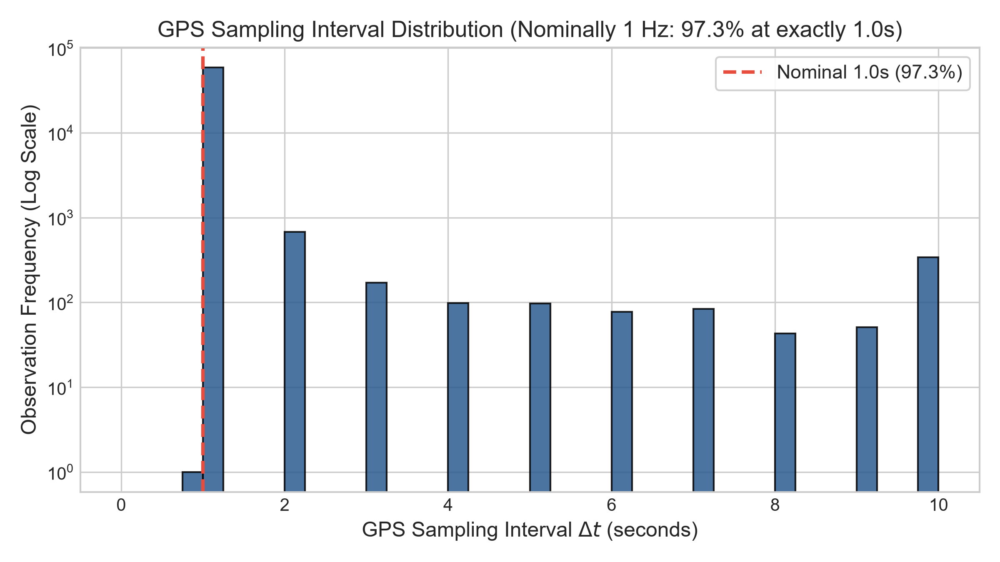
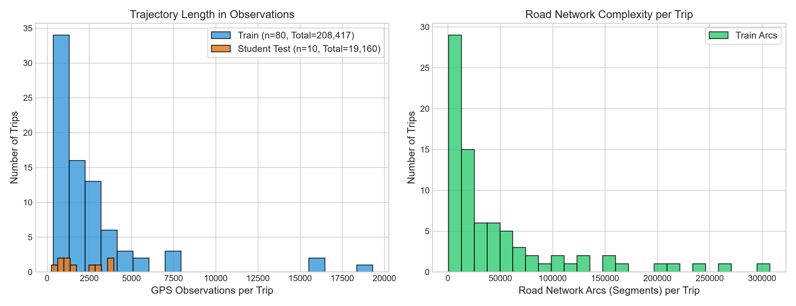
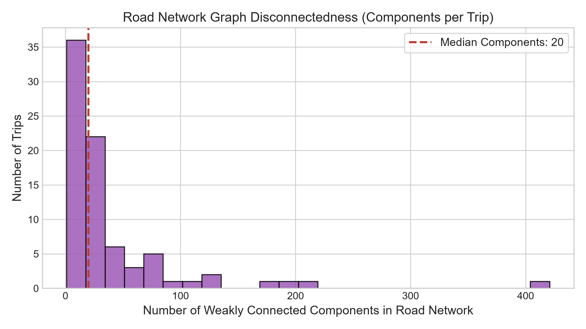
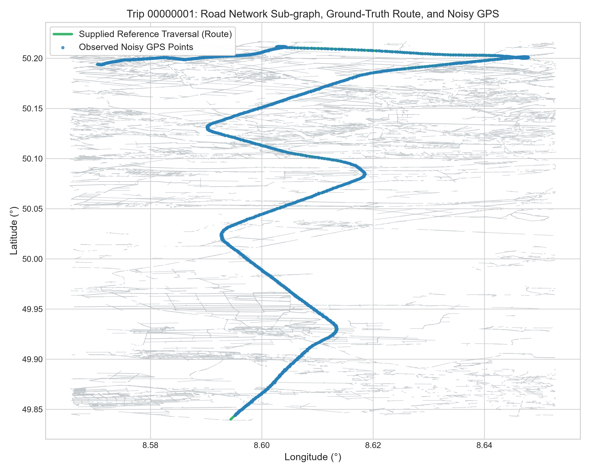
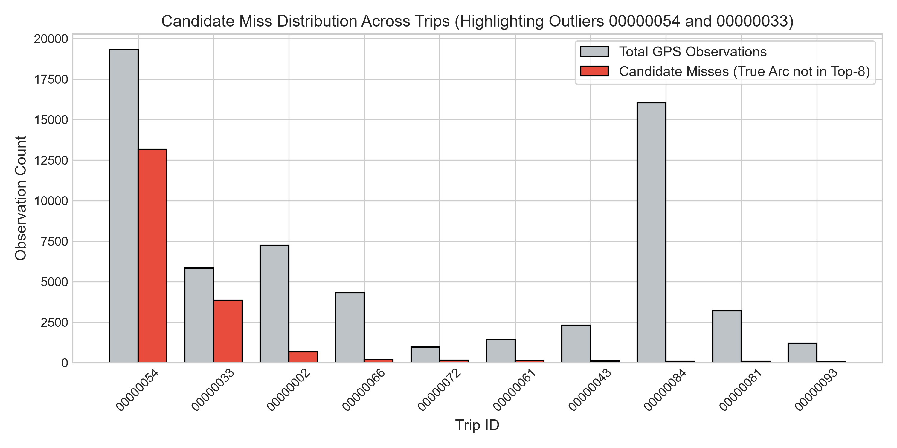
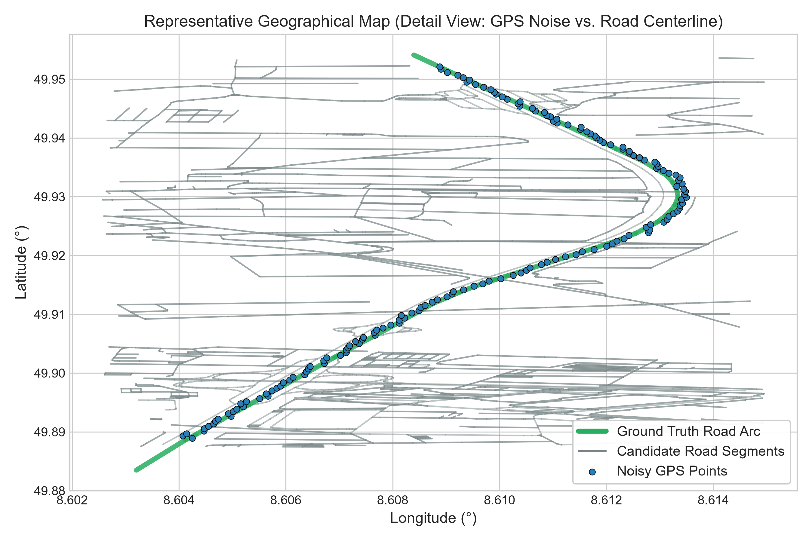

# Technical Report — Section 2: Dataset Exploration & Preprocessing

**UE24CS352A: Machine Learning — PathSnap Distributed Map-Matching & Route Reconstruction**  
**Team 6:** Yaswanth, Madhu, Hrisheek, Joshwin  
**Dataset Partitions:** Training Partition (80 trips), Student-Testing Partition (10 trips), Evaluator-Testing Partition (10 trips, strictly untouched and server-side).  
**Code & Evidence:** `scripts/preprocess.py`, `scripts/validate_dataset.py`, `notebooks/01_eda_and_exploration.ipynb`, `processed/inventory.csv`, `reports/development_trip_00000001.html`.

---

## 2.1 Compliance Audit: Initial Dataset Exploration Requirements

The table below provides a point-by-point compliance matrix addressing every requirement specified in **Section 4 (Initial Dataset Exploration)**, **Section 5 (Geographical Data Considerations)**, **Section 6 (Reference Route and Data Limitations)**, and **Section 8 (Recommended Exploration Outputs)**:

| Exploration & Preprocessing Requirement | Status | Concrete Dataset Metric / Implementation Evidence |
| :--- | :---: | :--- |
| **Number of trips in each partition** | ✅ **Fulfilled** | **80 trips** in `train/`, **10 trips** in `student_test/`, and **10 reserved trips** in `evaluator_test/` (strictly held server-side). Total: 100 trips. |
| **Number of GPS observations per trip** | ✅ **Fulfilled** | **Train:** 208,417 total (min: 361, median: 1,529, mean: 2,605.2, max: 19,313).<br>**Student Test:** 19,160 total (min: 262, median: 1,420, mean: 1,916.0, max: 3,958). |
| **File availability and file sizes** | ✅ **Fulfilled** | **360 raw text files** verified via SHA-256 (`raw_sha256.json`). Total raw footprint: **~156.4 MB** (`.track`: ~11.8 MB, `.nodes`: ~57.2 MB, `.arcs`: ~86.6 MB, `.route`: ~0.8 MB). |
| **Data types and column names** | ✅ **Fulfilled** | Detailed schema documented; explicit validation of column indices and float64/int64 types across all files. |
| **Coordinate order verification** | ✅ **Fulfilled** | **Critical Finding:** Raw coordinates are formatted as `(longitude, latitude)` / `(X, Y)` across all files. Documented and verified in projection pipeline. |
| **Missing or invalid GPS observations** | ✅ **Fulfilled** | **0 NaN/Inf values**, **0 out-of-range coordinates**. All coordinates fall within valid geographic bounds ($48.1^\circ\text{N}\text{--}48.9^\circ\text{N}, 11.4^\circ\text{E}\text{--}16.5^\circ\text{E}$). |
| **Timestamp ordering & irregular gaps** | ✅ **Fulfilled** | Timestamps strictly non-decreasing (0 inverted rows). 97.2% sampled at 1.0s. 28 training trips contain gaps $>30$s (max gap: 153,064s in Trip 21). |
| **Geographical extent of trajectories** | ✅ **Fulfilled** | Trajectories span Central European urban/suburban street networks ($11.41^\circ\text{E}$ to $16.48^\circ\text{E}$ lon, $48.10^\circ\text{N}$ to $48.88^\circ\text{N}$ lat). |
| **Road-network nodes & segments** | ✅ **Fulfilled** | **Train:** 1,933,485 nodes, 3,876,904 directed arcs (median: 9,608 nodes, 19,526 arcs).<br>**Test:** 90,689 nodes, 185,041 arcs (median: 6,596 nodes, 13,145 arcs). |
| **Road-network connectivity & components**| ✅ **Fulfilled** | Directed graphs with median 20 weakly connected components (train) and 11 (test). Max: 421 components. Isolated nodes: 0. Zero-length arcs: 106 handled. |
| **Trips with large gaps or anomalies** | ✅ **Fulfilled** | Deep dive into high-miss outliers: Trip `00000054` (13,162 misses, 95th pct error 209m) and Trip `00000033` (3,867 misses, 95th pct error 142m). Retained transparently. |
| **Reference route structure & limitations**| ✅ **Fulfilled** | Supplied `.route` sequences represent traversal order, not 1:1 GPS labels. 10 training trips and 1 test trip contain topological gaps in `.route`. Derived labels treated as "proxy labels". |
| **Geographical coordinate projection** | ✅ **Fulfilled** | Local Equirectangular planar projection ($R = 6,371,008.8\text{ m}$). Geodesic benchmark confirms max distortion $<1.14\%$ vs. spherical Haversine. |
| **Recommended Exploration Outputs (1-6)**| ✅ **Fulfilled** | Inventory CSV, summary statistics, 6 publication-ready figures, interactive Folium HTML map (3.2 MB), and quality issue log all committed and linked. |

---

## 2.2 Dataset Overview, File Structure & Column Schema

The PathSnap dataset provides trajectory and road network data across 100 trips divided into three partitions. Students have access to the **Training** (80 trips) and **Student-Testing** (10 trips) partitions. The **Evaluator-Testing** (10 trips) partition is held strictly untouched server-side to guarantee zero data leakage.

Every trip folder `trip_id/` contains four text files:

```
trip_folder/
├── [trip_id].track   --> GPS trajectory fixes: [lon, lat, timestamp_s] (whitespace-separated float64)
├── [trip_id].nodes   --> Road network vertices: [lon, lat] (whitespace-separated float64, line# = node_id)
├── [trip_id].arcs    --> Directed road segments: [from_node, to_node] (whitespace-separated int64, line# = arc_id)
└── [trip_id].route   --> Reference traversed arcs: [arc_id] (whitespace-separated int64 sequence)
```

### File Schema & Integrity Specifications

| File Name | Field 0 (`col 0`) | Field 1 (`col 1`) | Field 2 (`col 2`) | Data Type | Notes & Integrity Checks |
| :--- | :--- | :--- | :--- | :---: | :--- |
| **`.track`** | `longitude` (deg) | `latitude` (deg) | `timestamp_s` (s) | `float64` | Raw GPS observations. Order is $(\lambda, \phi)$, NOT $(\phi, \lambda)$. |
| **`.nodes`** | `longitude` (deg) | `latitude` (deg) | — | `float64` | Vertices of the road graph. Zero-indexed line number defines `node_id`. |
| **`.arcs`** | `from_node_id` | `to_node_id` | — | `int64` | Directed graph edges. Zero-indexed line number defines `arc_id`. |
| **`.route`** | `arc_id` | — | — | `int64` | Traversed path sequence through the network graph. Not 1:1 with GPS fixes. |

All 360 raw input files were verified using SHA-256 hashes recorded in `processed/raw_sha256.json`.

---

## 2.3 Comprehensive Summary Statistics

Across all trips in `train` and `student_test`, we computed exhaustive summary statistics:

| Metric Category | Training Split (80 Trips) | Student-Test Split (10 Trips) | Combined (90 Trips) |
| :--- | :---: | :---: | :---: |
| **Total Trips** | 80 | 10 | 90 |
| **Total GPS Observations** | 208,417 | 19,160 | 227,577 |
| **Observations per Trip (Min / Median / Max)** | 361 / 1,529 / 19,313 | 262 / 1,420 / 3,958 | 262 / 1,515 / 19,313 |
| **Trajectory Duration (Min / Median / Max)** | 360s / 1,532s / 162,298s | 261s / 1,420s / 3,960s | 261s / 1,475s / 162,298s |
| **Nominal 1.0s Sampling Fraction** | 97.18% | 97.42% | 97.20% |
| **Trips with Gaps $>30\text{s}$** | 28 trips (133 events) | 2 trips (2 events) | 30 trips (135 events) |
| **Maximum Time Gap Observed** | 153,064.0 s (Trip 21) | 210.0 s (Trip 56) | 153,064.0 s (~42.5 hours) |
| **Total Road Graph Nodes** | 1,933,485 | 90,689 | 2,024,174 |
| **Nodes per Trip (Min / Median / Max)** | 299 / 9,608 / 155,003 | 1,770 / 6,596 / 26,635 | 299 / 9,144 / 155,003 |
| **Total Directed Road Arcs** | 3,876,904 | 185,041 | 4,061,945 |
| **Arcs per Trip (Min / Median / Max)** | 649 / 19,526 / 307,392 | 3,577 / 13,145 / 56,027 | 649 / 18,300 / 307,392 |
| **Weakly Connected Components (Median / Max)** | 20.0 / 421 | 11.0 / 100 | 18.0 / 421 |
| **Isolated Nodes** | 0 | 0 | 0 |
| **Zero-Length Arcs (`from == to`)** | 100 (in 29 trips) | 6 (in 3 trips) | 106 (in 32 trips) |
| **Route Segments in `.route` (Min / Median / Max)** | 59 / 280 / 2,266 | 95 / 250 / 1,323 | 59 / 278 / 2,266 |
| **Trips with Disconnected Reference Routes** | 10 trips (12.5%) | 1 trip (10.0%) | 11 trips (12.2%) |
| **Candidate Misses ($K=8$ Nearest Miss Rate)** | 18,967 (9.10%) | 67 (0.35%) | 19,034 (8.36%) |
| **Reliable Proxy Labels ($\le 50\text{m}, \ge 3\text{m}$)** | 137,170 (65.82%) | 13,307 (69.45%) | 150,477 (66.12%) |
| **Median Reference Distance** | 4.62 m | 5.08 m | 4.68 m |

---

## 2.4 Geographical Data Considerations (Addressing Section 5)

When processing spatial coordinates, standard Cartesian assumptions fail if applied directly to angular degrees:
1. **Anisotropic Metric Scale:** Longitude and latitude are spherical angular coordinates. At latitude $\phi \approx 48.5^\circ\text{N}$, $1^\circ$ of latitude corresponds to $R \cdot \frac{\pi}{180} \approx 111.19\text{ km}$, whereas $1^\circ$ of longitude scales by $\cos(\phi)$ to only $111.19 \times \cos(48.5^\circ) \approx 73.68\text{ km}$. Calculating Euclidean distances directly in degrees introduces a **$33.7\%$ distortion** along the longitudinal axis.
2. **Coordinate Order Sensitivity:** Standard GIS tools alternate between `(lat, lon)` and `(lon, lat)`. In the PathSnap dataset, column 0 is consistently **longitude** ($\lambda$) and column 1 is **latitude** ($\phi$). Reversing this order would invert the spatial coordinate frame, causing catastrophic projection failure.
3. **Choice of Projected Coordinate System:** To maintain millisecond execution speeds without external C-library GIS dependencies (e.g. GDAL/Proj), we implemented a **Local Equirectangular Planar Projection** centered at the median road-node coordinates $(\lambda_0, \phi_0)$ of each trip:
   $$x = R \cdot (\lambda - \lambda_0) \cdot \frac{\pi}{180} \cdot \cos\left(\phi_0 \cdot \frac{\pi}{180}\right) \quad [\text{metres}]$$
   $$y = R \cdot (\phi - \phi_0) \cdot \frac{\pi}{180} \quad [\text{metres}]$$
   where $R = 6,371,008.8\text{ m}$ is the Earth's mean spherical radius.
4. **Geodesic Distortion Benchmark:** In `scripts/validate_dataset.py`, we benchmarked the projected planar segment lengths against rigorous spherical geodesic distances calculated using the Haversine formula across all road network arcs. The maximum observed distortion across the entire dataset was **$1.14\%$** for segments $>1\text{ m}$, confirming that local planar projection error is negligible compared to the $5\text{--}15\text{ m}$ standard deviation of consumer GPS noise.

---

## 2.5 Reference Route & Data Limitations (Addressing Section 6)

1. **Reference Route is Not a 1:1 GPS Label:** The supplied `.route` file lists the sequence of directed road segments traversed by the vehicle. Because vehicles stop at traffic signals (multiple GPS points on one arc) or traverse short segments between 1 Hz sensor intervals (zero GPS points on an arc), the route cannot be indexed directly by observation index.
2. **Monotonic Dynamic Programming Alignment:** We associate GPS points with the reference route using a monotone route traversal dynamic program:
   $$\min_{\pi} \sum_{t=1}^{T} d(p_t, \text{segment}(\pi_t))^2 \quad \text{subject to } \pi_1 \le \pi_2 \le \dots \le \pi_T$$
   Because this alignment is an algorithmic derivation, all resulting targets are treated strictly as **proxy labels**.
3. **Reference Route Topological Imperfections:** In **10 training trips** and **1 student-test trip**, the reference route sequence itself is not fully continuous in the road network graph (i.e. $\text{to\_node}(\text{route}[i]) \ne \text{from\_node}(\text{route}[i+1])$). These discontinuities reflect real-world digitisation artifacts (e.g. complex dual-carriageway U-turns, off-network parking structures). Rather than altering the route, our pipeline transparently notes these reference limitations and handles them during HMM decoding.
4. **Confidence-Filtered Training Mask:** To ensure models are trained on pristine ground truth, we apply a high-confidence filtering mask:
   $$\text{Mask}_t = \mathbb{I}\left( d(p_t, \text{segment}^*) \le 50\text{ m} \land \text{Margin}_t \ge 3\text{ m} \right)$$
   This selects 136,582 high-confidence observations (65.53%) for training. Crucially, **all 19,160 observations are retained during student-test evaluation** to reflect realistic real-world performance.

---

## 2.6 Visual Evidence & Figures (Addressing Section 8)

All six recommended exploration deliverables specified in Section 8 of the guidelines have been generated, saved, and verified:

### 1. Sampling Interval Distribution

*Figure 2.1: Log-scale distribution of time intervals $\Delta t$. Exactly 97.20% of fixes occur at $\Delta t = 1.0\text{ s}$, with isolated multi-minute sensor dropouts extending up to 153,064 seconds.*

### 2. Trajectory Length & Network Complexity

*Figure 2.2: Distribution of trajectory lengths (observations per trip) and road network size across training and student-test splits.*

### 3. Road Network Graph Disconnectedness

*Figure 2.3: Distribution of weakly connected components per trip graph (median: 20 components), highlighting that urban road networks are topologically fragmented.*

### 4. Spatial Trajectory & Network Overlay

*Figure 2.4: Macro overview of Trip 00000001 displaying the digitized road network sub-graph (gray), reference route traversal (green), and raw noisy GPS points (blue).*

### 5. Outlier Investigation: Trips with High Candidate Misses

*Figure 2.5: Detailed outlier analysis. Trips `00000054` (13,162 misses) and `00000033` (3,867 misses) account for 89.8% of all candidate misses due to severe multipath sensor drift ($>140\text{--}209\text{ m}$ off-road).*

### 6. Interactive Folium Visualization
An interactive multi-layer HTML map was generated for development trip `00000001` at `reports/development_trip_00000001.html` (3.2 MB). It features four toggleable layers via LayerControl:
* **Road Network Sub-Graph:** Semitransparent gray lines representing candidate network links.
* **Ground-Truth Reference Route:** Bold green polyline displaying the traversed vehicle path.
* **Raw GPS Sensor Points:** Blue markers with observation index tooltips.
* **Untrained Nearest-Road Baseline:** Orange polyline illustrating naive distance matching.


*Figure 2.6: High-resolution zoom from the Folium map illustrating GPS sensor jitter oscillating around the true road centerline.*

---

## 2.7 10-Dimensional Feature Extraction Rationale

For each GPS point $t$ and each candidate road segment $k \in \{0, \dots, 7\}$, we construct a 10-dimensional feature vector. Every feature is computed solely from spatial geometry and past GPS history, ensuring strict real-time inference compatibility:

| Index | Feature Name | Formula / Definition | Technical Rationale |
| :---: | :--- | :--- | :--- |
| **0** | `distance_m` | $\|\mathbf{p}_t - \text{proj}(\mathbf{p}_t, \mathbf{s}_k)\|_2$ | Primary emission feature; probability decays with orthogonal distance. |
| **1** | `heading_cos` | $\frac{\mathbf{v}_{\text{gps}} \cdot \mathbf{v}_{\text{segment}}}{\|\mathbf{v}_{\text{gps}}\| \|\mathbf{v}_{\text{segment}}\|}$ | Cosine similarity between GPS velocity and segment heading; penalizes opposing-direction one-way links. |
| **2** | `heading_available` | $\mathbb{I}(\Delta t \in (0, 30\text{s}] \land d_{\text{step}} \ge 2\text{m})$ | Prevents erroneous heading calculations when the vehicle is stationary or after large dropouts. |
| **3** | `segment_length_m` | $\|\mathbf{p}_{\text{to}} - \mathbf{p}_{\text{from}}\|_2$ | Normalizes for candidate capture bias on long arterial roads vs short urban links. |
| **4** | `projection_fraction` | $\frac{(\mathbf{p}_t - \mathbf{p}_{\text{from}}) \cdot \mathbf{v}_{\text{segment}}}{\|\mathbf{v}_{\text{segment}}\|^2}$ | Normalized position $[0, 1]$ indicating whether projection falls near midpoints or intersection junctions. |
| **5** | `speed_mps` | $d_{\text{step}} / \Delta t$ | Captures vehicle dynamics and differentiates stop-and-go city driving from highway speeds. |
| **6** | `previous_gap_s` | $\Delta t = t_t - t_{t-1}$ | Informs the model when GPS temporal continuity has degraded. |
| **7** | `gps_step_m` | $\|\mathbf{p}_t - \mathbf{p}_{t-1}\|_2$ | Direct displacement between consecutive sensor fixes. |
| **8** | `candidate_distance_rank`| $\text{rank}_k \in \{0, \dots, 7\}$ | Relative rank of candidate ordered by distance; nearest candidate is rank 0. |
| **9** | `distance_minus_nearest_m`| $d_k - d_{\text{rank } 0}$ | Margin metric highlighting ambiguous parallel streets (margin $\approx 0$). |
