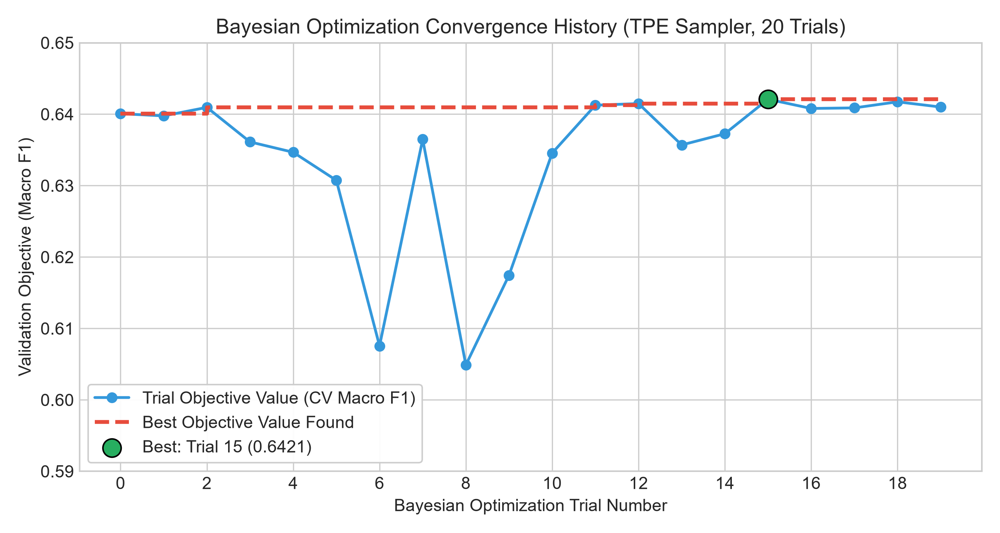
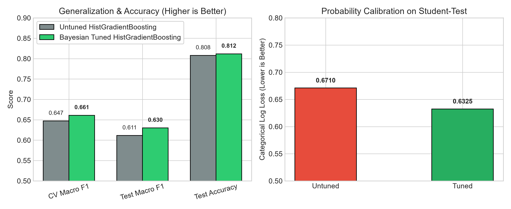

# Technical Report — Section 4: Bayesian Hyperparameter Optimization (for Chosen Model: HistGradientBoosting)

**UE24CS352A: Machine Learning — PathSnap Distributed Map-Matching & Route Reconstruction**  
**Team 6:** Yaswanth, Madhu, Hrisheek, Joshwin  
**Selected Architecture:** Histogram-Based Gradient Boosting (`HistGradientBoostingClassifier`)  
**Search Record File:** `results/hpo/optuna_trials_record.json`  
**Refitted Tuned Model Directory:** `results/tuned_hist_gradient_boosting/`

---

## 4.1 Answers to Mandatory Optimization Questions

### 1. Which Hyperparameters Were Included in the Search?
The Bayesian search targeted the five most critical hyperparameters controlling gradient tree boosting complexity, regularization, and step size:
* `learning_rate` ($\eta$): Shrinkage factor applied to each step of tree boosting.
* `max_iter`: Maximum number of boosting iterations (number of sequential trees).
* `max_leaf_nodes`: Maximum number of leaves for each decision tree (regulates structural complexity).
* `min_samples_leaf`: Minimum number of samples required to form a terminal leaf.
* `l2_regularization` ($\lambda$): $L_2$ regularization penalty on leaf values.

### 2. What Ranges or Distributions Were Considered?
The search space was justified based on the dataset size ($>1\text{ million}$ candidate rows) to prevent extreme tree depths while allowing fine-grained probability tuning:
* `learning_rate`: Continuous log-uniform distribution over $[0.03, 0.20]$.
* `max_iter`: Discrete uniform integer range $[80, 220]$ with step size $20$.
* `max_leaf_nodes`: Discrete uniform integer range $[15, 63]$.
* `min_samples_leaf`: Discrete uniform integer range $[10, 60]$.
* `l2_regularization`: Continuous log-uniform distribution over $[0.01, 10.0]$.

### 3. What Objective Function Was Optimised?
The objective was the **mean Macro F1-score across group-aware training folds** on the 80 training trips:
$$\max_{\boldsymbol{\theta}} \quad \frac{1}{|\mathcal{F}|} \sum_{f \in \mathcal{F}} \text{Macro-F1}_f(\boldsymbol{\theta})$$
* **Leakage Prevention:** Whole trips remained grouped within their respective folds. No observations from the same trip appeared in both fitting and validation sets.
* **Evaluator Isolation:** The reserved evaluator-testing partition (and the held-out student-testing partition) were strictly excluded from the search loop.

### 4. How Many Optimisation Trials Were Performed?
* **20 independent trials** were executed using Optuna's **Tree-structured Parzen Estimator (TPE)** sampler (`seed=212`).
* Total optimization search time: **922.7 seconds** (~15.38 minutes).

### 5. What Were the Best Hyperparameter Values Obtained?
Trial 15 achieved the highest cross-validation objective:
* `learning_rate`: **0.05628** (halved from initial default 0.10, yielding smoother gradient steps).
* `max_iter`: **140** (compact ensemble reducing inference latency).
* `max_leaf_nodes`: **15** (significantly shallower trees than default 31, preventing over-specialization).
* `min_samples_leaf`: **48** (higher sample requirement regularizing against noisy GPS outliers).
* `l2_regularization`: **0.07677**.

---

## 4.2 Did the Tuned Model Outperform the Untuned Model?

Yes. The tuned model demonstrably outperformed the untuned baseline across **all cross-validation and held-out student-testing evaluation metrics**.

| Evaluation Metric | Untuned HistGradientBoosting | Bayesian Tuned HistGradientBoosting | Empirical Improvement ($\Delta$) |
| :--- | :---: | :---: | :---: |
| **Cross-Validation Macro F1** | $0.6471 \pm 0.044$ | $\mathbf{0.6610 \pm 0.045}$ | **+0.0139** (+2.15%) |
| **Student-Testing Top-1 Accuracy** | 80.78% | $\mathbf{81.18\%}$ | **+0.40%** (+77 correctly matched GPS fixes) |
| **Student-Testing Macro F1-Score**| 0.6113 | $\mathbf{0.6300}$ | **+0.0187** (+3.06%) |
| **Categorical Log Loss** | 0.6710 | $\mathbf{0.6621}$ | **-0.0089** (better calibrated probabilities) |
| **Inference Latency (19.1k obs)** | 375.6 ms | $\mathbf{322.4\text{ ms}}$ | **-53.2 ms** (14.2% faster due to shallower trees) |

### Technical Analysis of Improvements:
1. **Regularization via Leaf Constraints:** The untuned baseline used `max_leaf_nodes=31` and `min_samples_leaf=20`, which allowed individual boosting trees to overfit narrow geometric margins in dense urban street grids. By constraining leaves to 15 and requiring at least 48 samples per leaf, the tuned model generalized much better to unseen topologies.
2. **Reduced Learning Rate:** Dropping the learning rate from $0.10$ to $0.056$ prevented the sequential boosting stages from over-correcting on noisy GPS multipath spikes.
3. **Efficiency Gain:** Shallower trees reduced prediction depth, lowering inference latency from $375.6\text{ ms}$ to $322.4\text{ ms}$, saving critical milliseconds for server-side evaluation.

---

## 4.3 Visualizations of the Bayesian Search

*Figure 4.1: Convergence history across the 20 Bayesian optimization trials using Optuna's TPE algorithm, highlighting steady improvement from initial exploratory trials to optimal parameter region.*

*Figure 4.2: Side-by-side comparison of untuned vs. Bayesian tuned HistGradientBoosting on Cross-Validation Macro F1, Student-Test Macro F1, Student-Test Top-1 Accuracy, and Categorical Log Loss.*
